# RutaH&D2 V2 — Diagrama completo de relaciones

Fuente: el DDL en español de 34 tablas. Uniones: 56 claves foráneas.

```mermaid
erDiagram
    roles {
        bigint id PK
        varchar codigo
        varchar nombre
        varchar descripcion
        datetime creado_en
        datetime actualizado_en
    }
    permisos {
        bigint id PK
        varchar codigo
        varchar descripcion
    }
    roles_permisos {
        bigint rol_id PK
        bigint permiso_id PK
    }
    usuarios {
        bigint id PK
        bigint rol_id
        varchar nombre
        varchar correo_electronico
        varchar hash_contrasena
        tinyint activo
        datetime ultimo_acceso_en
        datetime creado_en
        datetime actualizado_en
    }
    clientes {
        bigint id PK
        varchar codigo
        varchar nombre
        varchar rut
        varchar correo_electronico
        varchar telefono
        varchar direccion
        varchar comuna
        varchar sector
        text observaciones
        tinyint activo
        datetime creado_en
        datetime actualizado_en
    }
    proveedores {
        bigint id PK
        varchar nombre
        varchar rut
        varchar correo_electronico
        varchar telefono
        varchar direccion
        tinyint activo
        datetime creado_en
        datetime actualizado_en
    }
    categorias_productos {
        bigint id PK
        bigint padre_id
        varchar nombre
        tinyint activo
    }
    productos {
        bigint id PK
        bigint categoria_id
        bigint proveedor_id
        varchar sku
        varchar nombre
        text descripcion
        tinyint activo
        datetime creado_en
        datetime actualizado_en
    }
    presentaciones_productos {
        bigint id PK
        bigint producto_id
        varchar codigo_barras
        varchar nombre
        decimal unidades_por_envase
        decimal precio_neto
        decimal tasa_iva
        tinyint activo
        datetime creado_en
        datetime actualizado_en
    }
    imagenes_productos {
        bigint id PK
        bigint producto_id
        varchar ruta_archivo
        tinyint orden_visualizacion
        tinyint es_principal
        datetime creado_en
    }
    precios_clientes {
        bigint id PK
        bigint cliente_id
        bigint presentacion_id
        decimal precio_neto
        date vigente_desde
        date vigente_hasta
        datetime creado_en
    }
    bodegas {
        bigint id PK
        varchar codigo
        varchar nombre
        varchar tipo
        tinyint activo
    }
    saldos_inventario {
        bigint bodega_id PK
        bigint presentacion_id PK
        decimal cantidad
        datetime actualizado_en
    }
    movimientos_inventario {
        bigint id PK
        bigint presentacion_id
        bigint bodega_origen_id
        bigint bodega_destino_id
        decimal cantidad
        varchar tipo_movimiento
        varchar tipo_referencia
        bigint referencia_id
        text observaciones
        bigint realizado_por
        datetime creado_en
    }
    promociones {
        bigint id PK
        varchar titulo
        bigint cliente_destino_id
        datetime vigente_desde
        datetime vigente_hasta
        tinyint activo
        bigint creado_por
        datetime creado_en
        datetime actualizado_en
    }
    detalles_promociones {
        bigint id PK
        bigint promocion_id
        bigint presentacion_id
        decimal porcentaje_descuento
        decimal precio_neto
    }
    ordenes_compra {
        bigint id PK
        varchar numero
        bigint proveedor_id
        varchar estado
        datetime solicitada_en
        datetime recibida_en
        decimal subtotal_neto
        decimal total_impuestos
        decimal total_bruto
        text observaciones
        bigint creado_por
        datetime creado_en
        datetime actualizado_en
    }
    detalles_ordenes_compra {
        bigint id PK
        bigint orden_compra_id
        bigint presentacion_id
        decimal cantidad
        decimal costo_unitario_neto
        decimal subtotal_neto
    }
    rutas_reparto {
        bigint id PK
        varchar codigo
        varchar nombre
        bigint usuario_repartidor_id
        varchar nombre_vehiculo
        tinyint activo
    }
    cotizaciones {
        bigint id PK
        varchar numero
        bigint cliente_id
        bigint usuario_vendedor_id
        varchar estado
        date vigente_hasta
        decimal subtotal_neto
        decimal total_descuentos
        decimal total_impuestos
        decimal total_bruto
        text observaciones
        datetime creado_en
        datetime actualizado_en
    }
    detalles_cotizaciones {
        bigint id PK
        bigint cotizacion_id
        bigint presentacion_id
        decimal cantidad
        decimal precio_unitario_neto
        decimal porcentaje_descuento
        decimal subtotal_neto
    }
    notas_venta {
        bigint id PK
        varchar numero
        bigint cliente_id
        bigint cotizacion_id
        bigint usuario_vendedor_id
        bigint ruta_reparto_id
        datetime entrega_programada_en
        varchar direccion_entrega
        varchar estado
        varchar estado_pago
        varchar medio_pago
        decimal subtotal_neto
        decimal total_descuentos
        decimal total_impuestos
        decimal total_bruto
        decimal monto_entregado_bruto
        text observaciones
        datetime creado_en
        datetime actualizado_en
    }
    detalles_notas_venta {
        bigint id PK
        bigint nota_venta_id
        bigint presentacion_id
        decimal cantidad_solicitada
        decimal cantidad_entregada
        decimal precio_unitario_neto
        decimal porcentaje_descuento
        decimal subtotal_neto
    }
    historial_estados_notas_venta {
        bigint id PK
        bigint nota_venta_id
        varchar estado_anterior
        varchar estado_nuevo
        bigint modificado_por
        text observaciones
        datetime creado_en
    }
    pagos_ventas {
        bigint id PK
        bigint nota_venta_id
        decimal monto_bruto
        varchar medio_pago
        datetime pagado_en
        varchar referencia
        text observaciones
        bigint registrado_por
        datetime creado_en
    }
    guias_despacho {
        bigint id PK
        varchar folio_interno
        bigint bodega_origen_id
        bigint bodega_destino_id
        bigint nota_venta_id
        decimal total_neto
        varchar estado
        bigint creado_por
        datetime creado_en
    }
    detalles_guias_despacho {
        bigint id PK
        bigint guia_despacho_id
        bigint presentacion_id
        decimal cantidad
        decimal precio_unitario_neto
        decimal subtotal_neto
    }
    documentos_emitidos {
        bigint id PK
        bigint nota_venta_id
        varchar tipo_documento
        varchar folio
        varchar sistema_emisor
        datetime emitido_en
        varchar estado
        varchar ruta_pdf
        varchar identificador_seguimiento_sii
        datetime creado_en
    }
    eventos_agenda {
        bigint id PK
        varchar tipo_evento
        varchar titulo
        text descripcion
        datetime inicia_en
        datetime finaliza_en
        bigint cliente_id
        bigint creado_por
        datetime creado_en
        datetime actualizado_en
    }
    metas_mensuales_ventas {
        bigint id PK
        date mes_objetivo
        decimal meta_bruta
        bigint actualizado_por
        datetime creado_en
        datetime actualizado_en
    }
    dias_laborales_programados {
        bigint id PK
        date mes_objetivo
        date fecha_laboral
        tinyint habilitado
        varchar observaciones
    }
    registros_auditoria {
        bigint id PK
        bigint usuario_id
        varchar accion
        varchar tipo_entidad
        bigint entidad_id
        longtext valores_anteriores
        longtext valores_nuevos
        datetime creado_en
    }
    ventas {
        bigint id PK
        bigint nota_venta_id
        bigint cliente_id
        varchar numero_venta
        varchar estado
        char codigo_moneda
        date fecha_emision
        smallint tipo_dte
        char dte_id_externo
        bigint dte_empresa_id
        bigint dte_sistema_externo_id
        bigint dte_folio_propuesto
        smallint dte_tipo_documento_sii_propuesto
        int dte_numero_sucursal
        int dte_numero_establecimiento
        varchar dte_codigo_sucursal_externa
        bigint dte_documento_remoto_id
        bigint dte_folio
        varchar dte_estado
        varchar dte_ambiente_sii
        varchar documento_receptor
        varchar nombre_receptor
        varchar giro_receptor
        varchar direccion_receptor
        bigint ciudad_receptor_id
        varchar correo_receptor
        decimal monto_neto
        decimal monto_exento
        decimal monto_impuestos
        decimal monto_descuento
        decimal monto_total
        json datos_encabezado_json
        json datos_referencias_json
        json dte_solicitud_json
        json dte_respuesta_json
        varchar dte_codigo_ultimo_error
        text dte_mensaje_ultimo_error
        datetime dte_solicitado_en
        datetime dte_creado_en
        datetime dte_aceptado_en
        datetime dte_rechazado_en
        text observaciones
        bigint creado_por
        datetime creado_en
        datetime actualizado_en
    }
    detalles_ventas {
        bigint id PK
        bigint venta_id
        bigint detalle_nota_venta_id
        bigint producto_id
        int numero_linea
        decimal cantidad
        decimal precio_unitario
        decimal porcentaje_descuento
        decimal monto_descuento
        tinyint exento_impuestos
        decimal monto_linea
        json datos_adicionales_json
        datetime creado_en
        datetime actualizado_en
    }
    roles ||--o{ roles_permisos : "rol_id"
    permisos ||--o{ roles_permisos : "permiso_id"
    roles ||--o{ usuarios : "rol_id"
    categorias_productos ||--o{ categorias_productos : "padre_id"
    categorias_productos ||--o{ productos : "categoria_id"
    proveedores ||--o{ productos : "proveedor_id"
    productos ||--o{ presentaciones_productos : "producto_id"
    productos ||--o{ imagenes_productos : "producto_id"
    clientes ||--o{ precios_clientes : "cliente_id"
    presentaciones_productos ||--o{ precios_clientes : "presentacion_id"
    bodegas ||--o{ saldos_inventario : "bodega_id"
    presentaciones_productos ||--o{ saldos_inventario : "presentacion_id"
    presentaciones_productos ||--o{ movimientos_inventario : "presentacion_id"
    bodegas ||--o{ movimientos_inventario : "bodega_origen_id"
    bodegas ||--o{ movimientos_inventario : "bodega_destino_id"
    usuarios ||--o{ movimientos_inventario : "realizado_por"
    clientes ||--o{ promociones : "cliente_destino_id"
    usuarios ||--o{ promociones : "creado_por"
    promociones ||--o{ detalles_promociones : "promocion_id"
    presentaciones_productos ||--o{ detalles_promociones : "presentacion_id"
    proveedores ||--o{ ordenes_compra : "proveedor_id"
    usuarios ||--o{ ordenes_compra : "creado_por"
    ordenes_compra ||--o{ detalles_ordenes_compra : "orden_compra_id"
    presentaciones_productos ||--o{ detalles_ordenes_compra : "presentacion_id"
    usuarios ||--o{ rutas_reparto : "usuario_repartidor_id"
    clientes ||--o{ cotizaciones : "cliente_id"
    usuarios ||--o{ cotizaciones : "usuario_vendedor_id"
    cotizaciones ||--o{ detalles_cotizaciones : "cotizacion_id"
    presentaciones_productos ||--o{ detalles_cotizaciones : "presentacion_id"
    clientes ||--o{ notas_venta : "cliente_id"
    cotizaciones ||--o{ notas_venta : "cotizacion_id"
    usuarios ||--o{ notas_venta : "usuario_vendedor_id"
    rutas_reparto ||--o{ notas_venta : "ruta_reparto_id"
    notas_venta ||--o{ detalles_notas_venta : "nota_venta_id"
    presentaciones_productos ||--o{ detalles_notas_venta : "presentacion_id"
    notas_venta ||--o{ historial_estados_notas_venta : "nota_venta_id"
    usuarios ||--o{ historial_estados_notas_venta : "modificado_por"
    notas_venta ||--o{ pagos_ventas : "nota_venta_id"
    usuarios ||--o{ pagos_ventas : "registrado_por"
    bodegas ||--o{ guias_despacho : "bodega_origen_id"
    bodegas ||--o{ guias_despacho : "bodega_destino_id"
    notas_venta ||--o{ guias_despacho : "nota_venta_id"
    usuarios ||--o{ guias_despacho : "creado_por"
    guias_despacho ||--o{ detalles_guias_despacho : "guia_despacho_id"
    presentaciones_productos ||--o{ detalles_guias_despacho : "presentacion_id"
    notas_venta ||--o{ documentos_emitidos : "nota_venta_id"
    clientes ||--o{ eventos_agenda : "cliente_id"
    usuarios ||--o{ eventos_agenda : "creado_por"
    usuarios ||--o{ metas_mensuales_ventas : "actualizado_por"
    usuarios ||--o{ registros_auditoria : "usuario_id"
    clientes ||--o{ ventas : "cliente_id"
    notas_venta ||--o{ ventas : "nota_venta_id"
    usuarios ||--o{ ventas : "creado_por"
    ventas ||--o{ detalles_ventas : "venta_id"
    detalles_notas_venta ||--o{ detalles_ventas : "detalle_nota_venta_id"
    productos ||--o{ detalles_ventas : "producto_id"
```

La herramienta de diagramas puede mostrar una red densa; para navegar todos los campos e índices se recomienda MySQL Workbench (Reverse Engineer).
