# RutaH&D2 V2 — Diagrama entidad relación, nombres en español

Diagrama Mermaid con 34 tablas y 56 FK. Las columnas están disponibles en el DDL y en el diccionario CSV.

```mermaid
erDiagram
    roles {
       bigint id PK
    }
    permisos {
       bigint id PK
    }
    roles_permisos {
       bigint id PK
    }
    usuarios {
       bigint id PK
    }
    clientes {
       bigint id PK
    }
    proveedores {
       bigint id PK
    }
    categorias_productos {
       bigint id PK
    }
    productos {
       bigint id PK
    }
    presentaciones_productos {
       bigint id PK
    }
    imagenes_productos {
       bigint id PK
    }
    precios_clientes {
       bigint id PK
    }
    bodegas {
       bigint id PK
    }
    saldos_inventario {
       bigint id PK
    }
    movimientos_inventario {
       bigint id PK
    }
    promociones {
       bigint id PK
    }
    detalles_promociones {
       bigint id PK
    }
    ordenes_compra {
       bigint id PK
    }
    detalles_ordenes_compra {
       bigint id PK
    }
    rutas_reparto {
       bigint id PK
    }
    cotizaciones {
       bigint id PK
    }
    detalles_cotizaciones {
       bigint id PK
    }
    notas_venta {
       bigint id PK
    }
    detalles_notas_venta {
       bigint id PK
    }
    historial_estados_notas_venta {
       bigint id PK
    }
    pagos_ventas {
       bigint id PK
    }
    guias_despacho {
       bigint id PK
    }
    detalles_guias_despacho {
       bigint id PK
    }
    documentos_emitidos {
       bigint id PK
    }
    eventos_agenda {
       bigint id PK
    }
    metas_mensuales_ventas {
       bigint id PK
    }
    dias_laborales_programados {
       bigint id PK
    }
    registros_auditoria {
       bigint id PK
    }
    ventas {
       bigint id PK
    }
    detalles_ventas {
       bigint id PK
    }
    roles ||--o{ roles_permisos : "rol_id"
    permisos ||--o{ roles_permisos : "permiso_id"
    roles ||--o{ usuarios : "rol_id"
    categorias_productos ||--o{ categorias_productos : "padre_id"
    categorias_productos ||--o{ productos : "categoria_id"
    proveedores ||--o{ productos : "proveedor_id"
    productos ||--o{ presentaciones_productos : "producto_id"
    productos ||--o{ imagenes_productos : "producto_id"
    clientes ||--o{ precios_clientes : "cliente_id"
    presentaciones_productos ||--o{ precios_clientes : "presentacion_id"
    bodegas ||--o{ saldos_inventario : "bodega_id"
    presentaciones_productos ||--o{ saldos_inventario : "presentacion_id"
    presentaciones_productos ||--o{ movimientos_inventario : "presentacion_id"
    bodegas ||--o{ movimientos_inventario : "bodega_origen_id"
    bodegas ||--o{ movimientos_inventario : "bodega_destino_id"
    usuarios ||--o{ movimientos_inventario : "realizado_por"
    clientes ||--o{ promociones : "cliente_destino_id"
    usuarios ||--o{ promociones : "creado_por"
    promociones ||--o{ detalles_promociones : "promocion_id"
    presentaciones_productos ||--o{ detalles_promociones : "presentacion_id"
    proveedores ||--o{ ordenes_compra : "proveedor_id"
    usuarios ||--o{ ordenes_compra : "creado_por"
    ordenes_compra ||--o{ detalles_ordenes_compra : "orden_compra_id"
    presentaciones_productos ||--o{ detalles_ordenes_compra : "presentacion_id"
    usuarios ||--o{ rutas_reparto : "usuario_repartidor_id"
    clientes ||--o{ cotizaciones : "cliente_id"
    usuarios ||--o{ cotizaciones : "usuario_vendedor_id"
    cotizaciones ||--o{ detalles_cotizaciones : "cotizacion_id"
    presentaciones_productos ||--o{ detalles_cotizaciones : "presentacion_id"
    clientes ||--o{ notas_venta : "cliente_id"
    cotizaciones ||--o{ notas_venta : "cotizacion_id"
    usuarios ||--o{ notas_venta : "usuario_vendedor_id"
    rutas_reparto ||--o{ notas_venta : "ruta_reparto_id"
    notas_venta ||--o{ detalles_notas_venta : "nota_venta_id"
    presentaciones_productos ||--o{ detalles_notas_venta : "presentacion_id"
    notas_venta ||--o{ historial_estados_notas_venta : "nota_venta_id"
    usuarios ||--o{ historial_estados_notas_venta : "modificado_por"
    notas_venta ||--o{ pagos_ventas : "nota_venta_id"
    usuarios ||--o{ pagos_ventas : "registrado_por"
    bodegas ||--o{ guias_despacho : "bodega_origen_id"
    bodegas ||--o{ guias_despacho : "bodega_destino_id"
    notas_venta ||--o{ guias_despacho : "nota_venta_id"
    usuarios ||--o{ guias_despacho : "creado_por"
    guias_despacho ||--o{ detalles_guias_despacho : "guia_despacho_id"
    presentaciones_productos ||--o{ detalles_guias_despacho : "presentacion_id"
    notas_venta ||--o{ documentos_emitidos : "nota_venta_id"
    clientes ||--o{ eventos_agenda : "cliente_id"
    usuarios ||--o{ eventos_agenda : "creado_por"
    usuarios ||--o{ metas_mensuales_ventas : "actualizado_por"
    usuarios ||--o{ registros_auditoria : "usuario_id"
    clientes ||--o{ ventas : "cliente_id"
    notas_venta ||--o{ ventas : "nota_venta_id"
    usuarios ||--o{ ventas : "creado_por"
    ventas ||--o{ detalles_ventas : "venta_id"
    detalles_notas_venta ||--o{ detalles_ventas : "detalle_nota_venta_id"
    productos ||--o{ detalles_ventas : "producto_id"
```

Los diagramas mermaid pueden resultar densos; para visualizar todos los campos use MySQL Workbench → Database → Reverse Engineer.
