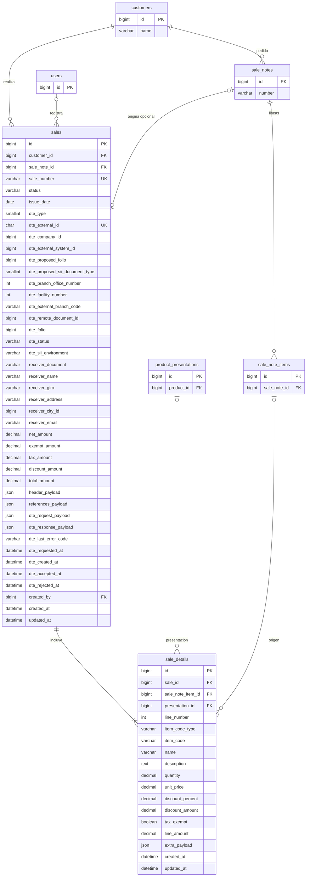

# RutaH&D2 — ampliación del ERD con DTE (2026-11-19)

Las **32 tablas existentes** de RutaH&D2 se mantienen sin cambios. Se proponen dos tablas nuevas, `sales` y `sale_details` (34 tablas al aplicar la migración).
**Estado de despliegue:** SQL versionado, todavía sin confirmar ejecución en InfinityFree.

El `company_id` del Servidor DTE no se envía en JSON: lo determina el JWT técnico.
Los campos `dte_company_id`, `receiver_city_id` y `dte_remote_document_id` son referencias al servidor **remoto**, no claves foráneas de la base local.

**Contrato inspeccionado:** `msanzana/sii-dte-backend` rama `develop`. No se ha confirmado un contrato explícito de versión `v2`.
