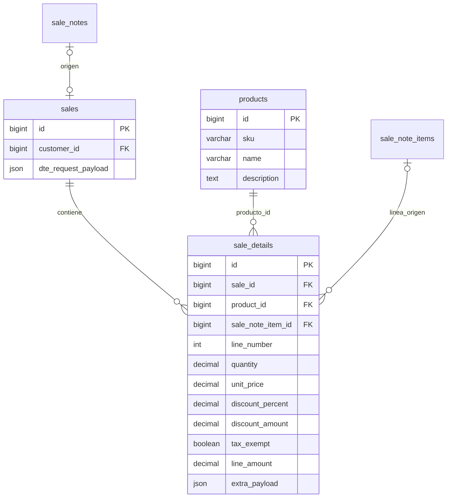

# Migración de sale_details a products.id — 2026-11-19

**Decisión:** `sale_details` tendrá como única referencia al catálogo `product_id` (FK obligatoria hacia `products.id`).
Los campos comerciales propios de la línea (cantidad, precio, descuento, exención y neto de línea) permanecen por motivos históricos/tributarios.
NO se duplican en `sale_details` el nombre, descripción, SKU ni tipo de código.

## Relaciones

## Despliegue según estado de MySQL
- Si `sales` y `sale_details` **aún no existen**, crear mediante `07_sales_dte_v2_contract.sql` (versión actualizada) o la migración `2026_11_19_000100`.
- Si ya existe `sale_details` con la columna `presentation_id`, **NO** volver a ejecutar el CREATE IF NOT EXISTS esperando que modifique la tabla. Utilizar `2026_11_19_000200` tras respaldo verificado; migra product_id mediante product_presentations, guarda un snapshot previo en extra_payload y retira el vínculo antiguo.
- Si existen líneas sin presentation_id mapeable, la migración se detiene sin borrar la información original.
- No ejecutar `migrate:fresh` ni modificar producción sin respaldo.
- Estado actual de ejecución remota: **no confirmado**. La rama GitHub no implica cambio directo en InfinityFree.

## Emisión DTE
`SaleDtePayloadService` obtiene de products los campos `name`, `sku` y `description` para el contrato DTE inspeccionado en `sii-dte-backend/develop`.
`buildAndFreeze(id)` guarda el JSON resultante en sales.dte_request_payload para reintentos inmutables. La integración HTTP con la API DTE sigue pendiente.
